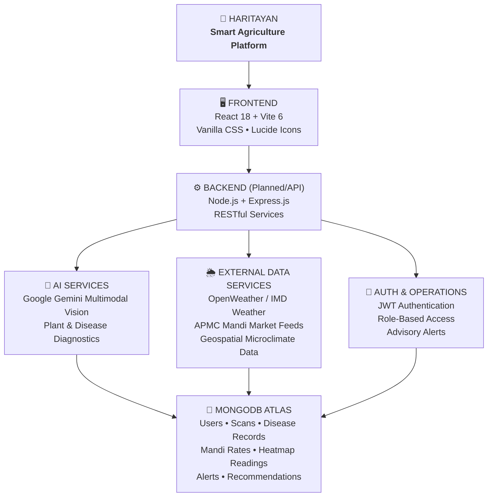

# Advanced Web Technologies and Software Engineering Project

# HaritAyan (हरित અયન)
> **AI-Powered Smart Agriculture, Urban Heat Mitigation & Plant Intelligence Platform**  
> *Developed for Vadodara District, Gujarat, India*

[](https://reactjs.org/)
[](https://vitejs.dev/)
[](https://developer.mozilla.org/en-US/docs/Web/CSS)
[](https://www.mongodb.com/atlas)
[](https://ai.google.dev/)
[]()

---

## 📖 Overview

**HaritAyan** is an AI-powered smart agriculture and plant management platform developed to assist farmers, gardeners, researchers, and urban planners in monitoring plant health, predicting microclimatic changes, and improving crop productivity. The system integrates computer vision, machine learning, and environmental data analysis to identify plant species, detect crop diseases, analyze thermal microclimates, and provide actionable bilingual recommendations.

By allowing users to upload leaf photos, HaritAyan recognizes visible disease symptoms (e.g., fungal spots, viral curls, bacterial blights) and recommends scientifically validated and organic remedies. Concurrently, the platform models urban heat islands (UHI) across Vadodara municipal wards and tracks real-time agricultural commodity prices from APMC markets across Vadodara District in both English and Gujarati.

---

## 🌿 Why "Harit Ayan"?

**Harit Ayan** is derived from two Sanskrit-rooted words:

- **Harit (हरित)** represents green, greenery, vegetation, biological vitality, and environmental sustainability.
- **Ayan (अयन)** represents an intentional path, journey, or purposeful movement towards a destination.

Together, **Harit Ayan** represents a **"Journey Towards a Greener Future."**

Rather than treating agricultural disease, urban heat, and market realization as isolated issues, HaritAyan establishes a closed-loop digital pathway:
$$\text{Understand Conditions} \longrightarrow \text{Take Informed Action} \longrightarrow \text{Measure Impact} \longrightarrow \text{Improve Decisions}$$

---

## 🧩 Core Modules

| Module | Scope & Functionality | Local Context & Target |
|---|---|---|
| **Module 1: Urban Heat Mitigation Map & Cooling Simulator** | Interactive thermal grid tracking surface temperatures across Vadodara wards (Alkapuri, Makarpura, Sayaji Baug, Manjalpur) and simulating the cooling effect of planting native canopy trees (Neem, Peepal, Jamun). | Urban planners, municipal authorities, environmental researchers |
| **Module 2: Gemini AI Multimodal Vision Scanner** | Computer vision engine diagnosing foliar diseases on staple Gujarat crops (Cotton, Castor, Pigeon Pea, Tomato, Okra) with organic bio-friendly remedies in English and Gujarati. | Farmers, agronomists, home gardeners |
| **Module 3: Real-Time APMC Mandi Engine** | Live commodity price ticker tracking arrivals, modal rates, and 24h price trends across 5 Vadodara mandis (Sayajigunj, Padra, Karjan, Dabhoi, Savli). | Farmers, wholesale traders, agricultural cooperatives |
| **Module 4: Operations & Early Warning Panel** | Centralized dashboard for managing heatwave advisories, agro-climatic alerts, Mandi data synchronization, and AI diagnostics telemetry. | System administrators and agricultural extension officers |

---

## 🎨 Design Philosophy & Theme

HaritAyan is styled exclusively using custom **Vanilla CSS** with a carefully crafted **Light Green & Dry Leaf Organic Theme** designed to evoke nature, soil, and vegetation:

- **Canvas & Surface:** Light warm botanical wash (`#fbf9f5` / `#ffffff`) with subtle organic background gradients.
- **Fresh Plant Greens:** Deep forest and emerald hues (`#1b4332`, `#2d6a4f`, `#40916c`) for headings, primary actions, and brand identity.
- **Dry Leaf & Earth Accents:** Warm amber ochre and dry-leaf tones (`#c47335`, `#9e5320`, `#faeee2`) for badges, counters, and highlights.
- **Bilingual Typography:** Curated font pairing using `Outfit` for geometric headings, `Plus Jakarta Sans` for clean body typography, and `Noto Sans Gujarati` for crisp Gujarati regional script rendering.

---

## 🏗️ System Architecture



---

## 🛠️ Technology Stack

| Layer | Technology | Purpose |
|---|---|---|
| **Frontend Framework** | React 18 (`react`, `react-dom`) | Declarative, component-driven UI architecture |
| **Build Tool & Bundler** | Vite 6 (`@vitejs/plugin-react`) | Lightning-fast HMR and optimized asset bundling |
| **Styling** | Vanilla CSS (`index.css`) | Custom design tokens, responsive grid, zero external CSS dependencies |
| **Iconography** | Lucide React (`lucide-react`) | Lightweight, accessible SVG icons |
| **Internationalization** | Custom Bilingual Engine | Real-time English & Gujarati (`en` / `gu`) toggle |
| **AI / Machine Learning** | Google Gemini Vision API | High-resolution multimodal plant disease classification |
| **Database** | MongoDB Atlas (Cloud M0) | NoSQL document storage for telemetry, scans, and commodities |
| **Backend Runtime** | Node.js / Express.js | REST API routing and external service integration |

---

## 📂 Project Directory Structure

```text
HaritAyan/
├── .env.example                       # Environment variables template
├── .gitignore                          # Git exclusions for dependencies and sensitive files
├── README.md                           # Project documentation and setup guide
├── directory_structure.txt             # Workspace file registry
├── package.json                        # Root package definition and scripts
│
├── frontend/                           # React + Vite client application
│   ├── .gitignore
│   ├── index.html                      # HTML root template with Google Fonts
│   ├── package.json                    # Frontend dependencies and dev scripts
│   ├── vite.config.js                  # Vite configuration with React plugin
│   │
│   ├── public/                         # Static visual assets
│   │   ├── favicon.svg                 # HaritAyan sprout icon
│   │   └── images/                     # Organic imagery assets
│   │       ├── hero-banner.jpg         # Agricultural lush field showcase
│   │       ├── leaf-scanner.jpg        # Plant leaf scanner diagnostic photo
│   │       └── vadodara-heatmap.jpg    # Vadodara thermal grid visualization
│   │
│   └── src/                            # Application source code
│       ├── main.jsx                    # React entry point
│       ├── App.jsx                     # Top-level component with navigation and language state
│       ├── index.css                   # Global Light Green & Dry Leaf design system
│       │
│       ├── components/                 # Modular, reusable UI components
│       │   ├── Navbar.jsx              # Navigation header with language switch & mobile drawer
│       │   ├── Footer.jsx              # Bottom footer with module links & Vadodara hubs
│       │   ├── AlertCard.jsx           # Weather & microclimatic alert card
│       │   └── LanguageSelector.jsx    # English/Gujarati selector toggle
│       │
│       ├── pages/                      # Page views
│       │   └── Home.jsx                # Comprehensive overview page with module previews & FAQs
│       │
│       └── services/                   # Application services
│           └── translationService.js   # Bilingual string dictionaries (English & Gujarati)
│
└── backend/                            # Server-side REST API services (Under Development)
    └── .gitkeep
```

---

## 🚀 Quick Start & Installation

### Prerequisites
- **Node.js** (v18.0.0 or higher recommended)
- **npm** (v9.0.0 or higher) or yarn / pnpm
- A modern web browser (Chrome, Edge, Firefox, Safari)

### 1. Clone the Repository
```bash
git clone https://github.com/developerved2312/awt_se_project.git
cd awt_se_project
```

### 2. Configure Environment Variables
Copy `.env.example` to create your local environment file:
```bash
cp .env.example frontend/.env
```
Update `frontend/.env` with your API credentials (optional for UI exploration):
```env
VITE_GEMINI_API_KEY=your_gemini_api_key_here
VITE_OPENWEATHER_API_KEY=your_openweather_api_key_here
VITE_BACKEND_URL=http://localhost:5000/api
```

### 3. Install Dependencies
Navigate into the `frontend` directory and install the packages:
```bash
cd frontend
npm install
```

### 4. Run Development Server
```bash
npm run dev
```
Open your browser and navigate to **`http://localhost:5173`**.

### 5. Build for Production
To create an optimized production build:
```bash
npm run build
```
The output will be generated inside `frontend/dist/`. To preview the production bundle locally:
```bash
npm run preview
```

---

## 🔑 API Keys & Environment Configuration Guide

HaritAyan is designed to run seamlessly out of the box with zero required API keys using built-in public endpoints and authentic regional fallbacks, while also supporting production API keys for enhanced real-time data:

| Service / Variable | Status | How to Obtain | Fallback if Omitted |
|---|---|---|---|
| **`VITE_MAPBOX_TOKEN`**<br/>*(Frontend Map Tiles)* | Optional | 1. Sign up at [account.mapbox.com](https://account.mapbox.com/) (Free 50,000 map loads/month).<br/>2. Copy your default public access token (`pk.eyJ...`).<br/>3. Add to `frontend/.env`: `VITE_MAPBOX_TOKEN="pk.eyJ..."` | Defaults automatically to high-resolution **CartoDB Voyager** raster tiles (`cartocdn.com`) with zero configuration or keys required. |
| **`OPENWEATHER_API_KEY`**<br/>*(Weather Overlays)* | Optional | 1. Sign up at [openweathermap.org/api](https://openweathermap.org/api) (Free tier 1,000 calls/day).<br/>2. Add to `backend/.env`: `OPENWEATHER_API_KEY="your_key"` | Real-time weather, ET₀, and rain probabilities automatically use the open **Open-Meteo API** (100% free, zero keys needed). |
| **`GEMINI_API_KEY`**<br/>*(AI Crop Vision Scanner)* | Optional | 1. Go to [Google AI Studio](https://aistudio.google.com/).<br/>2. Click **Create API Key**.<br/>3. Add to `backend/.env`: `GEMINI_API_KEY="AIzaSy..."` | Automatically falls back to HaritAyan's authentic botanical diagnostic rules engine with organic Gujarati remedies. |
| **`DATA_GOV_IN_API_KEY`**<br/>*(Live National Mandi Sync)* | Optional | 1. Register at [data.gov.in](https://data.gov.in/) (Open Government Data Platform India).<br/>2. Generate an API Key in the user dashboard.<br/>3. Add to `backend/.env`: `DATA_GOV_IN_API_KEY="579b..."` | Ships with authentic pre-ingested CSV/JSON benchmark rate records for all 5 Vadodara district market yards (`data/sample/mandi_rates.csv`). |
| **`MONGODB_URI`**<br/>*(Persistent Data Storage)* | **Configured** | See MongoDB Atlas setup below. Pre-configured in `backend/.env` for cloud persistence of users, scans, and mandi prices. | In-memory session cache. |

---

## ☁️ MongoDB Atlas Setup Guide

To integrate MongoDB Atlas for persistent storage of scan reports and mandi data:

1. **Create an Account:** Sign up at [mongodb.com/atlas](https://www.mongodb.com/atlas).
2. **Deploy Free Cluster:** Select **M0 Free Tier** and pick the **AWS / Mumbai (`ap-south-1`)** region for lowest latency in Gujarat.
3. **Database Access:** Create a database user with username and a secure password (e.g. `harit_user`).
4. **Network Access:** In **Network Access**, add an IP Access List entry:
   - For local development: click **"Add Current IP Address"** or use `0.0.0.0/0` (allow access from anywhere with credentials).
5. **Connection String:**
   - Click **Connect** → **Drivers** (Node.js).
   - Copy your connection string:
     ```text
     mongodb+srv://harit_user:<password>@cluster0.xxxxx.mongodb.net/haritayan_db?retryWrites=true&w=majority
     ```
6. **Set Environment Variable:** Place this URI in your backend `.env` file under `MONGODB_URI`.

---

## ❓ Frequently Asked Questions (General FAQs)

### Q1: What is HaritAyan and who is it designed for?
**A:** HaritAyan is an AI-powered smart agriculture and environmental intelligence platform specifically customized for Vadodara District. It is created for local farmers, commercial horticulturists, botanical researchers, and urban planners to monitor plant health, reduce crop loss, mitigate urban heat islands, and maximize harvest realization through live market rates.

### Q2: How does the Gemini AI Vision Scanner identify crop diseases?
**A:** Users submit or upload a close-up photo of an affected plant leaf or crop canopy. The multimodal Gemini Vision model analyzes foliar patterns, chlorophyll degradation, discoloration, and lesion morphology. It then outputs a diagnostic summary, confidence score, and both organic (bio-friendly) and chemical recommendations in English and Gujarati.

### Q3: How does the Urban Heat Island Mitigation Simulator calculate cooling in Vadodara?
**A:** The simulator correlates empirical satellite thermal surface readings with canopy coverage percentages across Vadodara wards (such as Makarpura, Alkapuri, and Sayaji Baug). It simulates the thermodynamic transpiration and shading benefits of planting native trees (such as Neem, Peepal, and Jamun), forecasting microclimatic cooling drops up to -3.4°C.

### Q4: Which APMC mandis are covered for live agricultural market rates?
**A:** HaritAyan monitors daily commodity arrivals, minimum-maximum price bands, and modal trading prices across 5 major APMCs in Vadodara District:
- **Sayajigunj APMC** (Central Vadodara)
- **Padra APMC** (Vegetable and cotton hub)
- **Karjan APMC** (Cotton and cash crop center)
- **Dabhoi APMC** (Pigeon pea and pulses market)
- **Savli APMC** (Grains and oilseeds trading)

### Q5: Is the application accessible in the Gujarati language?
**A:** Yes. HaritAyan is built with native bilingual capability. Every element — from navigation headers and weather warnings to disease diagnostics and commodity tickers — can be toggled instantly between English and Gujarati (ગુજરાતી) using the header language selector.

### Q6: Can this platform be extended to other districts or cities in Gujarat?
**A:** Absolutely. The modular architecture is designed to support geographic expansion by configuring new APMC mandi feeds, microclimate weather coordinates, and local crop varieties across other districts such as Anand, Bharuch, and Surat.

---

## 📜 Academic Project Notice & License

This project was developed as part of the **Advanced Web Technologies (AWT) & Software Engineering (SE)** coursework.

© 2026 HaritAyan. All rights reserved.
